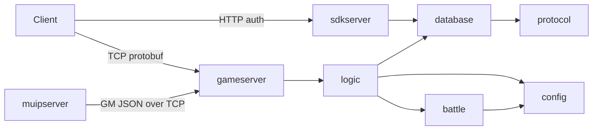

# Repository Guidelines

## Project Overview

Enigma is a Rust server emulator for the PC client of *Reverse: 1999* (currently v3.8.0 Steam/Global). It's a Cargo workspace (edition 2024) with an HTTP SDK/auth server, an authoritative TCP game server with a deterministic battle engine, SQLite persistence, and a web GM panel (MUIP).

## Architecture & Data Flow

Three binaries run in this order: `sdkserver`, then `gameserver`, then `muipserver` (MUIP proxies to the game server's GM listener, so it has to start last).

| Server | Protocol | Default port | Config key |
|---|---|---|---|
| `sdkserver` | HTTP (axum) | 21000 | `server.http_port` |
| `gameserver` | TCP | 23301 | `server.game_port` |
| `gameserver` GM bridge | TCP, line-delimited JSON | 21101 | `muip_gm.port` / `muip.gm_port` |
| `muipserver` | HTTP (axum) | 21100 | `muip.port` (token `"1999"`) |



Every crate depends on `common`. `protocol` builds as the crate `sonettobuf`.

**Game packet path** (`gameserver/src/net/`):
1. **Inbound framing.** `net/packet` reads an 11-byte header `[len: i32][seq: i32][cmd_id: i16][up_tag: u8]` followed by a protobuf body.
2. **Dispatch.** `net/router::dispatch_command` maps `CmdId` through the `dispatch!` macro to `handlers::<module>::on_<cmd>`, for example `CmdId::LoginCmd => system::on_login`.
3. **Handling.** The handler decodes with `prost::Message::decode`, gets `&mut ConnectionContext`, and builds a player-scoped `logic` manager (for example `HeroManager::new(player_id)`) from `ctx.state.db` and `ctx.state.tables`.
4. **Outbound.** Replies go out through `ctx.send_reply()` and pushes through `push::send_*`, each framed with a 10-byte header `[len: u32][cmd_id: i16][result: u16][up_tag: u8][down_tag: u8]`.

**Battle engine boundary.** `battle` is pure in-memory logic with no DB and no async. The runtime (`battle/src/engine/runtime`) must read game data through the normalized `battle::catalog::BattleCatalog`, never through raw `config::` or `.game_data()`. `battle/tests/boundary.rs` enforces this, along with dependency whitelists for `battle`, `battle_check`, and `battle_preview`.

## Key Directories

- `gameserver/src/handlers/` has 54 handler modules, one per feature (`hero`, `summon`, `dungeon`, `room`, ...). `net/` holds framing, routing, context, and outbound pushes. `gm.rs` is the MUIP bridge.
- `logic/src/` holds server-independent gameplay domain logic, one module per feature, organized as `*Manager` types.
- `battle/src/` holds the combat engine (`engine/`, `catalog/`, `dungeon/`, `tower/`) plus `test_support.rs`.
- `battle_check/` is a CLI for capability coverage and wire-capture parity. `battle_preview/` normalizes captures, expands fight steps, and checks determinism.
- `database/src/` has `db/` (queries split into `game/`, `user/`, `starter_data/`) and `models/`. Migrations live in `database/migrations/NNN_name.sql`.
- `config/configs/*.rs` is **generated**. `config/src/*.rs` holds handwritten query helpers (`activity_query.rs`, `hero.rs`, `dungeon.rs`, ...).
- `protocol/include/_.rs` is **generated** prost code and is committed.
- `common/src/` holds `ServerConfig` (`config.rs`), `init_tracing`, time utilities, and shared types.
- `data/excel2json/` holds game JSON tables. It's gitignored and must be cloned from `https://gitlab.com/yoncodes/sonetto-data.git`.

## Development Commands

```bash
# Build the servers
cargo build --release -p gameserver -p sdkserver -p muipserver

# Run them locally, in this order
cargo run -p sdkserver
cargo run -p gameserver
cargo run -p muipserver

# Regenerate config tables after the upstream schema changes
cargo run -p config_codegen            # defaults: data/excel2json -> config/configs

# Regenerate protobuf (needs sonetto.proto + cmd_id.proto in protocol/, which are gitignored)
ENIGMA_REGEN_PROTO=1 cargo build -p protocol

# Battle capability coverage (exits 1 on gaps)
cargo run -p battle_check -- --coverage-plan
cargo run -p battle_check -- --battle-report all --report-dir <PATH>

# Inspect captures
cargo run -p battle_preview --example inspect_capture -- <PATH> <BUFF_ID>
cargo run -p battle_preview --example expand_fight_steps -- <PATH>
```

There is no `rustfmt.toml`, `clippy.toml`, or `[workspace.lints]`, so run `cargo fmt` and `cargo clippy` with their defaults.

## Code Conventions & Common Patterns

- **Naming.** Packet handlers are named `on_<action>` (for example `on_item_unlock`) and registered in the `dispatch!` table. Domain types are named `<Feature>Manager`. Migrations take the next number, as in `097_<feature>.sql`.
- **Errors.** Typed domain errors use `thiserror`: `AppError` in `gameserver/src/error.rs` and `LogicError` in `logic/src/error.rs`. Binaries, CLIs, and setup code use `anyhow::Result`.
- **Async.** The servers run on multi-threaded `tokio`. `gameserver/src/main.rs` sets a 16 MB thread stack because of deep recursion and heavy serde parsing, so keep that setting if you touch the runtime builder. Keep `battle` synchronous.
- **State and DI.** `gameserver` leaks its `AppState` (holding a `SqlitePool`, `GameDB`, and `DashMap`s for sessions and parked battles) to get a `&'static`. `sdkserver` passes a cloned `AppState` into axum through `with_state`. Global singletons (`common::config()`, `config::configs::get()`) are `OnceLock`s.
- **DB access.** Queries use runtime `sqlx::query` / `query_as` rather than the compile-time macros, so you don't need `DATABASE_URL` or a `.sqlx` cache. Schema changes go in a new migration file. Don't edit existing migrations, because a checksum mismatch makes `database::migrate_or_rescue` rebuild the schema in `db/sonetto.db.rescue`, restore rows into it, copy the original to `.bak`, and swap the rebuilt file in on boot. A DB migrated by a newer build (applied version above the newest known migration) is refused at startup instead.
- **Generated code.** Never hand-edit `config/configs/*.rs` (it carries a "Do not edit manually" header) or `protocol/include/_.rs`. Put custom lookups in `config/src/`. Wire-format compatibility fixes belong in `protocol/src/normalize.rs`.
- **Logging.** Use `tracing` macros (`info!`, `warn!`, `error!`). Battle diagnostics turn on through the `ENIGMA_BATTLE_TRACE`, `ENIGMA_DAMAGE_TRACE`, `ENIGMA_DRAIN_TRACE`, and `ENIGMA_GAUGE_TRACE` env vars.

## Important Files

- Entry points: `gameserver/src/main.rs`, `sdkserver/src/main.rs`, `muipserver/src/main.rs`, `battle_check/src/main.rs`.
- Routing: `gameserver/src/net/router/` (`dispatch!`), `sdkserver` `handlers::router` (`router!` macro), `gameserver/src/gm.rs`.
- Config: `common/Config.toml` is the tracked template, embedded with `include_str!` and copied to `target/release/config.toml` by `common/build.rs`. The runtime config resolves in this order: `ENIGMA_CONFIG`, then `./config.toml`, then `<exe_dir>/config.toml`, and if none exists it's auto-created from the template.
- Build: root `Cargo.toml` (profiles), `.cargo/config.toml` (`jobs = 6`), `protocol/build.rs`, `common/build.rs`.
- MUIP UI: `muipserver/res/index.html`, embedded with `include_str!`.
- CI: `.github/workflows/rust.yml` and `sync-upstream.yml`.

## Runtime/Tooling Preferences

- Use the Rust nightly toolchain, pinned to `nightly-2025-12-06` in CI. There's no `rust-toolchain.toml`, so install it manually if stable fails. Cargo is the only build tool.
- The only database is SQLite (`sqlx` 0.8, `runtime-tokio-rustls`), at `./db/sonetto.db` by default. You don't need Docker or any external service.
- The dev profile builds dependencies and the `config` crate at `opt-level = 2` so that serde JSON loading stays fast. Don't remove that.
- Gitignored items you'll need locally: `data/`, `config.toml`, `db/`, `*.proto`, and `battle_preview/fixtures/`.
- Git flow: branch from and open PRs against `dev`. `main` only fast-forwards from `dev`. Make one bounded change per PR, link the issue (`Refs #...`), and fill in the `.github/PULL_REQUEST_TEMPLATE.md` checklist, including the AI-disclosure box.

## Testing & QA

- Tests use the std `#[test]` harness plus `#[tokio::test]`, with no mocking or assertion crates.
- Run everything with `cargo test`, or one crate with `cargo test -p battle`, `cargo test -p database --test equipment`, or `cargo test -p battle --test boundary`. `sdkserver` and `muipserver` have no tests.
- Tests in `battle`, `gameserver`, `logic`, `config`, and `battle_check` need `data/excel2json`. Override its location with `ENIGMA_BATTLE_DATA_DIR`. Load it with `config::init(&dir)` or `battle::test_support::init_config()`.
- DB tests use an in-memory pool:
  ```rust
  let pool = SqlitePool::connect("sqlite::memory:").await.unwrap();
  database::run_migrations(&pool).await.unwrap();
  ```
- Replay tests that depend on private captures are gated behind `--features private-fixtures` (in `battle`, `battle_check`, and `battle_preview`) and need `battle_preview/fixtures/battles/`.
- CI only builds release bundles and **doesn't run tests**. Before you open a PR, run `cargo test` for the crates you touched, plus `cargo run -p battle_check -- --coverage-plan` if you changed battle code. There's no coverage threshold.
